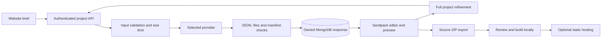

# Free AI and workflow review

Reviewed: 22 October 2026.

For the latest workflow findings and editor improvements, see the [24 October website builder review](website-builder-roadmap.md). The completed changes and verification below describe the earlier AI-provider review.

**Later update:** Users can now connect their own paid APIs (GPT, Claude, Grok, Gemini, Groq and OpenRouter). The free-only rules below describe the shared application default. Personal keys and billing are covered in [API connections](api-connections.md). Provider availability and free quotas can change.

## Recommendation

Start by evaluating **Flint through OpenRouter's `recursive/flint-v1.0:free` endpoint** against the old Groq model, using the same website briefs. It is a coding-focused candidate with no local GPU requirement. Keep **Ollama + Qwen2.5-Coder 7B** as the local option. Groq and OpenRouter are inference providers; model choice and the generation pipeline determine much of the output quality. No live comparison has been run, so this is a recommendation to evaluate, not a measured quality improvement.

| Option | Where it runs | Free condition | Fit for this project |
| --- | --- | --- | --- |
| Flint `recursive/flint-v1.0:free` | OpenRouter | Free endpoint, account quotas and provider capacity | First hosted coding candidate; implemented as an optional provider |
| `openrouter/free` | OpenRouter | Routes among free models; quotas apply | Useful for experimentation; randomly selected models make quality less repeatable |
| Gemini 3.8 Flash / Gemini 2.5 Flash | Google Gemini API | Eligible free-tier project and quota; do not enable paid billing | Alternative hosted candidates; not integrated in this change |
| Qwen2.5-Coder 7B | Local Ollama | No inference API charge; needs existing hardware and electricity | Current default; 4.7 GB weights, plus runtime/context memory |
| Qwen3-Coder 30B | Local Ollama | No inference API charge; substantially larger hardware requirement | 19 GB weights, plus runtime/context memory; unsuitable with the roughly 10 GiB currently available on this workstation |

Official references: [Flint free endpoint](https://openrouter.ai/recursive/flint-v1.0:free), [free router behavior](https://openrouter.ai/openrouter/free), [OpenRouter quotas](https://openrouter.ai/docs/api/reference/limits), [Gemini pricing](https://ai.google.dev/gemini-api/docs/pricing), [Gemini account limits](https://ai.google.dev/gemini-api/docs/rate-limits), [local 7B model](https://ollama.com/library/qwen2.5-coder:7b), [local 30B model](https://ollama.com/library/qwen3-coder).

The public model catalogue was checked as well as product pages. `qwen/qwen3-coder:free` was absent from the live catalogue even though its product page remained online. MiniMax M3.1 Flash advertised a free promotion ending on 22 October 2026 at 12:00 UTC; it is not a suitable persistent free default. See the [public catalogue](https://openrouter.ai/api/v1/models) and [MiniMax promotion notice](https://openrouter.ai/minimax/minimax-m3.1-flash:free). The configured hosted default is therefore `openrouter/free`; set `AI_MODEL=recursive/flint-v1.0:free` to evaluate a specific currently listed coding model. Run `make ai-models` to refresh the list before switching. Listing does not guarantee available inference capacity.

Hosted free inference is not unlimited. Check the actual account quota before relying on it for multiple users. Gemini's free-tier pricing states that content can be used to improve Google's products. OpenRouter requests leave this machine and are processed by the selected provider; review that provider's data policy. Local inference avoids sending prompts to those hosted providers, although the existing browser preview still uses external services.

## Configuration now available

### Local, no hosted account

Keep these values in the root `.env` for Docker:

```dotenv
AI_PROVIDER=ollama
AI_MODEL=qwen2.5-coder:7b
AI_FREE_ONLY=true
AI_MAX_OUTPUT_TOKENS=8192
AI_MAX_INPUT_CHARS=24000
OLLAMA_CONTEXT_LENGTH=16384
```

```sh
make dev-up
make ai-pull MODEL=qwen2.5-coder:7b
```

A different `MODEL` in `make ai-pull` only changes the download. Also change `AI_MODEL` in `.env` and run `make dev-restart` to use it. The supplied Compose service uses CPU inference unless GPU access is configured separately. A small local model may be slower or less capable than the previous hosted model.

### Hosted, restricted to free endpoints

Set both provider and model; leaving an Ollama model tag will correctly fail validation:

```dotenv
AI_PROVIDER=openrouter
AI_MODEL=openrouter/free
AI_FREE_ONLY=true
OPENROUTER_API_KEY=your-server-side-key
```

Then run `make dev-restart`. For native development use `backend/.env` and restart the API. Keep the key on the server, never in `VITE_` variables. Use an account without purchased credits or paid billing. No account, key, subscription, or credits were created during this review.

The adapter accepts only a `vendor/model:free` ID or `openrouter/free`, sends zero prompt/completion/request price ceilings, and requests a provider that supports the JSON and token-limit parameters. If none can serve the request, it fails. It does not retry automatically, switch to paid models, or request paid plugins. The [provider routing documentation](https://openrouter.ai/docs/guides/routing/provider-selection) describes the price filter.

`AI_FREE_ONLY` defaults to `true`, including for existing environment files. This blocks the legacy Groq adapter because its account billing state cannot be verified by this application. Deliberately setting `AI_FREE_ONLY=false` restores legacy Groq access with its existing key/model settings, outside the free-only guarantee. OpenRouter remains restricted to free model IDs even with that flag disabled.

The input limit includes the system instructions, prior source and new prompt. It is a character guard, not an exact token counter. Larger sites require a larger model context and appropriate memory. Output limits are explicit; truncated responses are rejected instead of saved. There is no automatic paid overage path.

## Flow reviewed



### Fixed in this review

- Renamed `routes/groq.js` to `routes/projects.js`; kept authenticated `/api/groq/*` HTTP aliases for existing clients.
- Split AI orchestration, provider transport/configuration, and project validation into separate modules.
- Added optional OpenRouter free-only requests and `make ai-models` for current catalogue discovery; retained local inference as the default.
- Added explicit input/output limits, local context settings, and distinct errors for quota, access, missing model, empty output, and truncation.
- Validate required Vite files, manifest JSON, scripts, dependencies, metadata, file count, paths and duplicate normalized filenames before database insertion. This is structural validation, not a build or security scan.
- Validate prior project JSON before inference; `/update` now requires a prior project.
- Improved generation instructions for working interactions, complete imports, accessible layouts, and project-specific design.
- `make dev-restart` now recreates API/UI containers so edits to `.env` take effect; plain container restart did not reload Compose environment values.
- Added regression tests without consuming API quota or downloading models.

### Remaining gaps, in priority order

| Priority | Finding and evidence | Recommended free implementation |
| --- | --- | --- |
| 1 | `Builder.jsx` stores manual edits only in sessionStorage; the API saves generated responses | Add authenticated draft save with a stable project ID and revision number, plus optimistic concurrency; migrate existing generated responses without guessing legacy ownership |
| 1 | Manifest/file checks do not prove generated code builds; Sandpack rewrites the entry point and omits Vite config | Build exported projects in isolated disposable workers with resource/time limits and no application credentials; show build errors before publishing |
| 2 | Each update sends and regenerates the whole source tree | Adopt a validated changed-file contract with explicit deletions, apply patches to a saved revision, and reject conflicting edits; reduces quota use and loss of unchanged code |
| 2 | Generation is a synchronous request with a 180-second provider timeout | Persist job states and add cancellation/progress, using MongoDB-backed jobs for a single-instance starting point; CPU inference may exceed the current timeout |
| 2 | `/deploy` provides a ZIP, with no publishing API | Use the manual Cloudflare Pages flow below first; integrated publishing needs isolated builds, narrowly scoped credentials and deployment status records |
| 3 | The app has per-user rate limits; users on the shared default still share its provider quota (personal BYOK is now supported) | Add a server-wide concurrency/queue limit and quota tracking before inviting multiple users; free-provider quotas remain the ceiling |
| 3 | Sessions have no revocation or password recovery; rate limits are in memory | Before public hosting, add cookie-based sessions with CSRF protection, account recovery, and shared rate-limit storage if scaling beyond one API instance |

These are separate product changes, not completed features. Database schema and migration history were not changed in this review. New project/draft/revision tables or collections should use new timestamped migrations; never modify applied migration files.

## Folder structure

The current frontend/backend split is appropriate for this application's size. A framework or database rewrite is not needed to access better models.

```text
backend/
  app.js, index.js          HTTP composition and process lifecycle
  routes/projects.js       Provider-independent generation endpoints
  services/ai/
    index.js               Generation orchestration
    providers.js           Provider selection, free-only policy, HTTP errors
    project.js             Generated-project contract validation
    errors.js              Safe HTTP error helper
  models/                  Persistence
  migrations/              Immutable versioned schema/data changes
  tests/                   API, AI policy, and migration tests
frontend/src/
  pages/                   Route-level screens
  components/              Shared UI and editor integration
  services/                API boundary
  lib/                     Browser state and pure helpers
```

When persistent projects and deployments arrive, group their services by domain (`projects/`, `deployments/`). Keep provider names out of public route names. Moving every file now would add churn without solving the flow defects above.

## Other integrations: keep or replace

- **Keep MongoDB and Mongoose locally.** The existing owner filters and migration runner already use them. There is no demonstrated benefit from a database migration just to change models, and a managed free tier would introduce another quota.
- **Keep Mailpit for development.** It captures mail locally and does not send production messages. Real customer email delivery needs a separate provider decision.
- **Keep Sandpack for the lightweight preview for now.** It still depends on a hosted bundler, npm and the Tailwind browser CDN. Export/build verification should establish correctness; the preview cannot be treated as the production Vite build.
- **Use Cloudflare Pages Free for generated static sites.** Export, review, install dependencies and run `npm run build`, then upload the generated `dist` folder using [Direct Upload](https://developers.cloudflare.com/pages/get-started/direct-upload/) or connect a Git repository with the Vite build command and `dist` output. Upload compiled output, not the source ZIP. The free plan documents 500 Git builds/month, 20,000 files/site, and 25 MiB/file; the included `pages.dev` address avoids buying a domain. This does not host the builder's Express/MongoDB/Ollama stack. See [Pages limits](https://developers.cloudflare.com/pages/platform/limits/).

## How to decide whether a model is actually better

Use the same three briefs for each candidate: a marketing site, a responsive dashboard, and a multipage portfolio. For each, request one follow-up change. Measure successful installs/builds, working interactions, mobile layout, accessibility, fidelity to the brief, latency, and whether the unchanged files survive refinement. Record model ID, date and quota failures. A model name or provider ranking alone does not establish better website quality.

Verification for this change: frontend lint and production build passed; 23 backend tests passed with local socket access, including AI policy, validation and API checks; the real-Mongo migration test was skipped because MIGRATION_TEST_URI was not configured. The public model-listing command and running API health check also passed. Live model quality, inference latency and account quotas have not been tested. The existing Sandpack bundle still emits a size advisory. No paid services were invoked.
