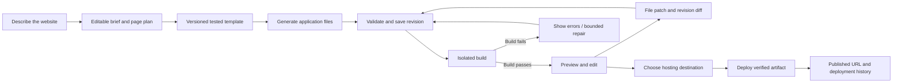

# Website builder: workflow and architecture review

Reviewed 24 October 2026. This document separates the current implementation from the proposed rebuild. Software and service terms were checked against the official links below; free quotas can change.

## Recommendation

Keep React/Vite/Tailwind, Express, MongoDB, Docker, versioned migrations, and the existing provider/BYOK adapters. Improve the project lifecycle before changing frameworks or adding another AI abstraction. The largest quality improvement will come from a tested scaffold, durable revisions, and actual build feedback—not from assuming one provider always writes better code.

Start with **static React websites**. Accounts, payments, databases, and server-rendered apps need a separate generation/deployment contract. Do not represent a generated contact form or login screen as a working backend integration.

## Findings

| Priority | Evidence | Change needed |
| --- | --- | --- |
| Critical for reliable publishing | `frontend/src/components/CodeEditor.jsx` adapts source for Sandpack's React runtime. It replaces entry HTML/JS and does not run the exported Vite configuration. `backend/services/ai/project.js` validates JSON and manifest shape only. | Treat this as a quick preview. Add a build of the exact saved revision before marking it ready to deploy. |
| High | `frontend/src/pages/Builder.jsx` saves manual edits to sessionStorage; `backend/routes/projects.js` inserts a new Response for every generation/refinement. | Stable Project IDs, server autosave, revision history, conflict detection, and restore. Browser session storage should become a recovery cache. |
| High | `backend/data/systemPrompt.js` asks the model to create the entire scaffold and dependency ranges. | Versioned, tested templates own build configuration and a real package-manager-generated lockfile. AI fills application files. |
| High | `backend/services/ai/index.js` sends prior source and replaces the whole project. | Explicit file upserts/deletions against a base revision. Preserve untouched files and show a diff. |
| High | Generation runs inside a long HTTP request, with no durable job state. | Background generation/build jobs, reconnectable progress, cancellation, bounded retries and account-wide concurrency. |
| Medium | `/deploy` exports source. No production artifact, deployment record, or published URL is stored. | Guided hosting now; later deploy only a successfully built artifact with explicit destination confirmation. |
| Medium | Backend routes mix generation and persistence; the editor previously combined source editing and synthetic preview files. | Introduce domain services as features land; keep HTTP controllers thin. Avoid moving unrelated files just for appearance. |

### Implemented during this review

- Extracted builder components/helpers into `frontend/src/features/builder/`.
- Added a collapsible folder explorer with create, rename, and delete actions. Nested file paths create the displayed folders; empty folders are not stored.
- Exposed all original source files, including the manifest and HTML. Preview adapter files are separate and never flow back into the saved/exported project.
- Fixed manual file changes being lost from refinement inputs or ZIP exports. Core entry files remain editable but cannot be deleted/renamed through the UI. Rename does not rewrite imports; the UI explains this.
- Added desktop/tablet/mobile width controls, a bounded preview console, manifest parse errors, and accurate quick-preview labeling. Widths are capped by available space; this is not device/browser emulation.
- Prevented manual source edits during AI refinement, so a returned revision cannot silently overwrite edits made while the request is running.
- Added guided Cloudflare Direct Upload/Git deployment instructions, clearly distinguishing source ZIPs from built `dist` assets.
- Improved generation instructions for focused components, meaningful folders, and a README. These are prompt instructions, not a deterministic template system.

No new runtime service, dependency, paid subscription, production deployment, or database migration was introduced in this increment. Server autosave, real build validation, patch generation, background jobs, and integrated publishing remain proposed work.

## Target user flow



1. **Brief:** collect audience, pages, style, content, and working interactions. Display inferred choices in an editable summary. Only interrupt for missing decisions that materially change the site.
2. **Plan:** identify routes, sections, assets, and supported integrations. Let users distinguish working features from mock data. Use deterministic defaults when another AI call would add little value.
3. **Scaffold:** copy a template such as `react-vite-tailwind@1`. Record its version, Node version and lockfile. Keep build scripts/configuration trusted in the first release; new dependencies require validation and a new lockfile.
4. **Generate:** select the user's model, validate file/schema/path limits, and save a candidate revision. Never include a user's AI key in the generated site or its environment.
5. **Check:** install/build in a disposable isolated worker. Capture bounded logs. Report syntax/import/build failures. A build passing does not prove UI quality: smoke-test routes, browser errors, mobile overflow, and the interactions requested in the brief.
6. **Preview:** show the checked revision, its build state, file explorer, logs, viewport controls, and restore action. Keep the last working preview while a candidate builds. Label draft/preview/published revisions separately.
7. **Refine:** use `baseRevision`, file upserts, explicit deletions, and a summary. Reject stale edits with HTTP 409. Apply changes atomically; save a failed candidate without replacing the last working revision. Permit at most one automatic repair initially, within an explicit model/usage budget.
8. **Publish:** choose a target account/project, show exactly which revision will publish, then upload its built artifact. Record remote ID, URL, logs, and status. Reuse a previous successful artifact for rollback. A source download is always available independently.

## Folder structure

### Generated website

Only create folders with actual files. Keep small sites small; add routes/hooks only when the brief needs them.

```text
website/
  package.json
  package-lock.json          # generated by npm; template/build tooling owns it
  index.html
  vite.config.js
  README.md                  # run, build, deployment, mock integration notes
  public/
    assets/
  src/
    main.jsx
    App.jsx                  # page composition / routes
    index.css                # Tailwind entry and shared styles
    components/
      layout/                # Header, Footer, page shell
      sections/              # Hero, Features, Contact
      ui/                    # genuinely reusable controls
    pages/                   # when the site has multiple pages
    lib/                     # shared data and pure helpers
    hooks/                   # only for reused behavior
```

### Builder application

Keep `frontend/` and `backend/` so Docker, Make targets and CI remain familiar. The following is the target structure; only the builder frontend extraction has been created in this review.

```text
frontend/src/
  pages/                     # route composition
  components/                # shared design system/layout
  features/
    builder/
      components/            # source explorer, preview, later revision UI
      lib/                   # source/preview transformations
    projects/                # later: workspace and server autosave
    connections/             # later: API settings
    deployments/             # later: target selection and status
  services/                  # authenticated HTTP and progress transport
backend/
  routes/                    # validation/auth/HTTP responses
  services/
    ai/                      # retain current provider adapters and key vault
    projects/                # ownership, revisions, conflicts, patch application
    generation/              # planner, template selection, bounded repair
    builds/                  # runner interface and build result handling
    deployments/             # artifact publication adapters
  workers/                   # separate generation/build job processes
  models/                    # Project, Revision, Job, Build, Deployment
  migrations/                # append-only migration history
  tests/
packages/
  contracts/                 # shared project/patch/job schemas, once needed
  templates/
    react-vite-tailwind/v1/  # verified scaffold with lockfile
```

Do not execute generated code in the API process. A worker controller should have narrowly scoped access to jobs/artifacts; the generated-code sandbox gets neither MongoDB credentials, provider keys, host filesystem mounts, nor the Docker socket. For public multi-user execution, use stronger isolation such as gVisor/microVMs, resource/PID/time limits, restricted network access and a separate preview origin. Build with trusted commands/configuration and curated dependencies initially. Disabling npm install hooks alone does not make arbitrary build code safe. [gVisor architecture](https://gvisor.dev/docs/).

## Data and API design

Proposed records:

- **Project:** owner, title, templateVersion, headRevision, lastSuccessfulBuild, timestamps.
- **Revision:** projectId, revision number, parent revision, file snapshot, source hash, brief/change summary, origin (AI/manual/restore).
- **Job:** owner/project, input revision, connection ID (never plaintext key), state, attempt count, lease/heartbeat, cancellation flag and sanitized progress.
- **Build:** exact revision/source hash, runner/toolchain version, status, artifact identifier, bounded logs and expiration.
- **Deployment:** owner, project, revision/build, target, remote deployment ID, URL and status. Separate hosting credentials from inference credentials.

Start with bounded snapshots in MongoDB while current project size limits remain. Use a storage adapter for build artifacts; local storage is suitable for development, not ephemeral production containers. Add retention, deletion and quota policies before public use.

Proposed endpoints (not implemented):

```text
POST /api/projects                         create stable project
GET  /api/projects/:id                     current project/revision
PUT  /api/projects/:id/draft               files + baseRevision; 409 on conflict
POST /api/projects/:id/generations         enqueue generation/refinement; 202
GET  /api/jobs/:id                         durable status
POST /api/jobs/:id/cancel                  stop pending/running work
GET  /api/jobs/:id/events                  reconnectable progress
GET  /api/projects/:id/revisions            history
POST /api/projects/:id/restores             restore as a new revision
POST /api/projects/:id/builds               build a specific revision
POST /api/projects/:id/deployments          publish a successful build
```

Enforce ownership on every read/write/event/artifact endpoint. Use idempotency keys for generation and publish requests. With current bearer authentication, use authenticated fetch streaming or polling; native EventSource cannot simply attach the existing Authorization header. Start with leased MongoDB jobs to avoid another service; a worker crash must let a lease expire, and duplicate completion must not create duplicate revisions/deployments.

Add a **new** migration for projects/revisions/indexes. Import existing Responses as separate owned projects using a unique legacyResponseId; there is no reliable evidence to infer which old responses belong to the same revision chain. Make backfill resumable/idempotent and preserve legacy reads until validated. Never edit the three already applied migrations.

## Tool choices and free conditions

| Area | Recommendation | Cost/limitation |
| --- | --- | --- |
| Editor | Keep Sandpack's existing CodeMirror editor; compose the file explorer around canonical files | Already installed; no new editor dependency. Monaco is optional if richer language tooling becomes necessary. |
| Quick preview | Keep Sandpack while adding a build-backed preview | Its runtime depends on external infrastructure; the current React adapter is not Vite. Sandpack also documents Nodebox/Vite support, worth a compatibility prototype before replacing it. |
| Verified builds | Separate self-hosted worker with hardened sandboxing | No hosted sandbox API is required on existing hardware; compute, storage and operations are still costs. Public untrusted-code execution needs isolation engineering. |
| Static hosting | Cloudflare Pages in the user's account | Free plan quotas: 500 Git builds/month, 20,000 files/site, 25 MiB per asset. This hosts generated static sites, not this app's Express/Mongo/Ollama stack. |
| AI | Keep local Ollama plus existing optional user-funded API connections | Local inference uses hardware/electricity. Shared hosted free endpoints have quotas; a personal GPT/Claude/Grok key can incur that user's charges. |
| Orchestration | Explicit jobs/state transitions with existing provider adapters | No need to add LangChain/LangGraph merely to generate files. Add a framework only for demonstrated orchestration requirements. |
| Contract validation | Shared JSON schema plus a validator when patch contracts land | Validate paths, sizes, dependencies and revision IDs deterministically; never rely solely on the prompt. |

Official references: [Sandpack capabilities and CodeMirror](https://sandpack.codesandbox.io/), [Sandpack Node/runtime distinction](https://sandpack.codesandbox.io/docs/advanced-usage/client), [Cloudflare limits](https://developers.cloudflare.com/pages/platform/limits/), [Direct Upload](https://developers.cloudflare.com/pages/get-started/direct-upload/).

### Attractive alternatives that are not an unconditional free default

- **WebContainers:** convenient in-browser Node execution, but commercial production API use requires a commercial license. Evaluate only if its licensing fits the project. [Commercial usage](https://webcontainers.io/enterprise).
- **E2B:** managed sandboxes reduce execution infrastructure work; Hobby includes one-time credits and usage charges. It is not indefinite free compute. [Pricing](https://e2b.dev/pricing).
- **Daytona:** managed sandbox candidate with a free trial and metered usage; do not treat trial credits as a sustainable free backend. [Pricing](https://www.daytona.io/pricing).

If these become optional paid execution providers, make their costs and credentials separate from AI BYOK. A user supplying an inference key has not automatically selected a paid sandbox account.

## Delivery order and acceptance gates

1. **Durable projects and revisions:** reload/cross-device recovery, owner isolation, stale-save conflicts, migration replay, and restore all work. This is the next backend priority.
2. **Tested template and real builds:** the same revision previews, downloads and builds; deliberate syntax/import/dependency errors are shown; failed candidates preserve the last working preview. Sandbox timeout and secret isolation are verified.
3. **Jobs and targeted refinements:** closing/reopening a tab recovers status; cancellation works; retries cannot duplicate mutations; untouched files remain byte-identical. Capture latency, model, token usage when supplied, and build success rate without logging secrets.
4. **Integrated deployment:** preview/publish share an artifact hash, target account is explicit, errors are recoverable, and published URL/rollback identify the exact revision.

Evaluate model quality with identical briefs (marketing site, multipage portfolio, dashboard) plus one follow-up change each. Measure build success, layout at mobile widths, working interactions, brief fidelity, unchanged-file preservation, latency and quota failures. No live model quality comparison was performed during this review.

## Verification

Frontend lint and production build passed; the builder bundle still has Vite's size advisory. File-integrity regression tests are included in `npm run check` and CI. AI unit tests passed with mocked provider responses. Browser checks cover file operations, original-source preservation in refinement/export, manifest error recovery, viewport controls, console UI, mobile overflow and deployment instructions. The hosted Sandpack runtime did not finish loading during the separate runtime check (requests to its bundler were aborted), so rendered-site correctness is unverified. No actual generated-site build, live AI inference, or deployment was invoked.
